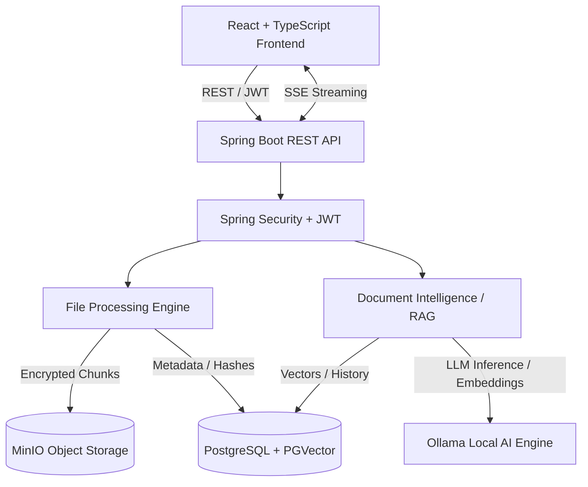

# ☁️ CloudVault — Secure Cloud Storage & AI-Powered Document Intelligence

**A full-stack cloud storage platform combining strong file encryption, parallel chunk processing, secure sharing, and local AI-powered document intelligence.**

CloudVault is built with React, TypeScript, Java, and Spring Boot. It enables users to securely store files, manage encrypted content, share documents through expiring links, and interact with their documents using Retrieval-Augmented Generation (RAG).

[**View Repository**](https://github.com/patilmrugesh/CloudVaultt)

---

## ✨ Key Features

- **🔐 AES-256-GCM Encryption** — Authenticated encryption to protect file content at rest.
- **⚡ Parallel Chunk Processing** — Concurrent chunk processing using Java `CompletableFuture` and thread pools.
- **♻️ SHA-256 Deduplication** — Detects identical chunks to reduce redundant storage.
- **📦 MinIO Object Storage** — S3-compatible storage for encrypted file chunks.
- **🔄 Resumable Uploads** — Upload sessions with chunk tracking and reassembly.
- **🤖 AI Document Assistant** — Generate summaries, detailed notes, and document-grounded answers.
- **🔎 Semantic Search** — Vector embeddings and similarity search using PostgreSQL PGVector.
- **🌊 Streaming AI Responses** — Incremental responses using Server-Sent Events (SSE).
- **🔑 JWT Authentication** — Stateless authentication and ownership-based authorization.
- **🔗 Secure File Sharing** — Time-limited share links with access controls.
- **📝 AI Interaction History** — Persistent history of document analysis and questions.

## 🏗️ System Architecture



### How It Works

1. **Upload:** Files are split into configurable chunks for concurrent processing.
2. **Encryption:** File content is encrypted using AES-256-GCM before storage.
3. **Storage:** Encrypted chunks are stored in MinIO, while file metadata and deduplication records are maintained in PostgreSQL.
4. **Ingestion:** PDF and text documents are processed to extract text and generate embeddings.
5. **Retrieval:** Relevant document chunks are retrieved using vector similarity search.
6. **Generation:** Ollama generates responses grounded in retrieved document context.
7. **Streaming:** AI responses are streamed to the frontend over SSE, and interactions are persisted for later retrieval.

## 🛠️ Tech Stack

| Layer | Technologies |
|---|---|
| Frontend | React, TypeScript, Vite |
| Backend | Java, Spring Boot, Spring Security |
| Authentication | JWT, access-control filters |
| Database | PostgreSQL, Spring Data JPA |
| Vector Database | PGVector, HNSW, cosine similarity |
| Object Storage | MinIO, S3-compatible API |
| AI Framework | Spring AI, Ollama |
| Language Model | Qwen3 8B |
| Embeddings | `nomic-embed-text` |
| Document Processing | Apache PDFBox |
| Cryptography | AES-256-GCM, SHA-256 |
| Concurrency | Java `CompletableFuture`, thread pools |
| Streaming | Project Reactor, Server-Sent Events |
| Build Tools | Maven, npm |
| Infrastructure | Docker |

## 📂 Project Structure

```text
CloudVaultt/
├── frontend/                  # React + TypeScript application
│   ├── src/
│   ├── public/
│   └── package.json
│
├── backend/                   # Spring Boot application
│   ├── src/
│   │   └── main/
│   │       ├── java/
│   │       └── resources/
│   ├── pom.xml
│   └── mvnw
│
├── docker-compose.yml          # Local services, if configured
├── .env.example                # Configuration template, if provided
├── .gitignore
└── README.md
```

*The structure above illustrates the intended monorepo layout. Adjust directory names and optional files to match the actual repository.*

## 🚀 Getting Started

### Prerequisites

- Git
- Java version supported by the backend `pom.xml`
- Node.js and npm
- PostgreSQL with the `pgvector` extension
- MinIO
- Ollama

### 1. Clone the Repository

```bash
git clone https://github.com/patilmrugesh/CloudVaultt.git
cd CloudVaultt
```

### 2. Configure PostgreSQL

Create the database:

```sql
CREATE DATABASE cloudvault;
```

Connect to the `cloudvault` database and enable PGVector:

```sql
CREATE EXTENSION IF NOT EXISTS vector;
```

Ensure the database connection settings match your local PostgreSQL configuration.

### 3. Configure Ollama

Install Ollama from [ollama.com](https://ollama.com).

Download the required models:

```bash
ollama pull qwen3:8b
ollama pull nomic-embed-text
```

Ensure Ollama is running and accessible at `http://localhost:11434`.

### 4. Configure Application Properties

Configure the backend's `application.properties` or environment variables for PostgreSQL, MinIO, JWT, Ollama, and CORS.

Example configuration:

```properties
spring.datasource.url=jdbc:postgresql://localhost:5433/cloudvault
spring.datasource.username=${DB_USERNAME}
spring.datasource.password=${DB_PASSWORD}

minio.url=http://localhost:9000
minio.accessKey=${MINIO_ACCESS_KEY}
minio.secretKey=${MINIO_SECRET_KEY}
minio.bucket=cloudvault

spring.ai.ollama.base-url=http://localhost:11434
spring.ai.ollama.chat.model=qwen3:8b
spring.ai.ollama.embedding.model=nomic-embed-text
```

Update ports and property names to match the actual application configuration.

**Never commit real credentials, JWT signing secrets, or private keys to GitHub.**

### 5. Run the Backend

Open a terminal:

```bash
cd backend
./mvnw clean spring-boot:run
```

Backend default URL: `http://localhost:8080`

On Windows, use `mvnw.cmd` instead of `./mvnw`.

### 6. Run the Frontend

Open another terminal:

```bash
cd frontend
npm install
npm run dev
```

Open the URL printed by Vite and ensure the frontend API URL and backend CORS settings match.

### 🐳 Docker

If the root Docker Compose file is configured for the application and its dependencies, start the services with:

```bash
docker compose up --build
```

For a standalone backend Docker build, run the command from the backend directory:

```bash
docker build -t cloudvault-backend .
```

Refer to the actual Docker configuration for service ports, environment variables, volumes, and health checks.

## 📡 API Reference

### Authentication

| Method | Endpoint | Description |
|---|---|---|
| `POST` | `/api/auth/register` | Register a user |
| `POST` | `/api/auth/login` | Authenticate and obtain a JWT |

### File Management

| Method | Endpoint | Description |
|---|---|---|
| `POST` | `/api/files/init-upload` | Initialize an upload session |
| `POST` | `/api/files/upload-chunk` | Upload a chunk |
| `POST` | `/api/files/complete-upload` | Finalize the upload |
| `GET` | `/api/files` | List the authenticated user's files |
| `GET` | `/api/files/{id}/download` | Download a file |
| `DELETE` | `/api/files/{id}` | Delete a file |
| `POST` | `/api/files/{id}/share` | Generate a time-limited share link |

### Document Intelligence

| Method | Endpoint | Description |
|---|---|---|
| `POST` | `/api/ai/documents/{fileId}` | Stream document summaries, notes, or answers |
| `GET` | `/api/ai/documents/{fileId}/history` | Retrieve AI interaction history |
| `POST` | `/api/rag/ingest/{fileId}` | Index a document for semantic retrieval |
| `GET` | `/api/rag/status/{fileId}` | Check indexing status |

Protected endpoints require a valid JWT unless explicitly configured otherwise.

## 🔒 Security Considerations

- AES-256-GCM provides confidentiality and integrity protection for encrypted file content.
- JWT authentication protects access to secured endpoints.
- Ownership validation restricts access to files and their associated AI interactions.
- Expiring share links limit the duration of shared access.
- Local Ollama inference supports document processing without relying on a hosted LLM API for the documented workflow.

**Production hardening:** Secure encryption-key management, HTTPS, rate limiting, upload validation, secret rotation, and monitoring should be addressed before public deployment.

## 🧠 Engineering Highlights

CloudVault brings together several practical backend engineering concepts:

- Concurrent file-processing pipelines and chunk reassembly.
- Authenticated encryption and hash-based deduplication.
- Integration of object storage with relational metadata.
- Semantic retrieval and context-grounded LLM generation.
- Reactive streaming and persistent AI interaction history.
- Stateless authentication and resource-level authorization.

## 👨‍💻 Author

**Mrugesh Patil**

Computer Engineering | Backend Engineering | Distributed Systems | Applied AI & Security

- **GitHub:** [@patilmrugesh](https://github.com/patilmrugesh)
- **Project Repository:** [CloudVaultt](https://github.com/patilmrugesh/CloudVaultt)

---

<p align="center">
  <b>CloudVault — Secure your files. Understand your documents.</b>
</p>
